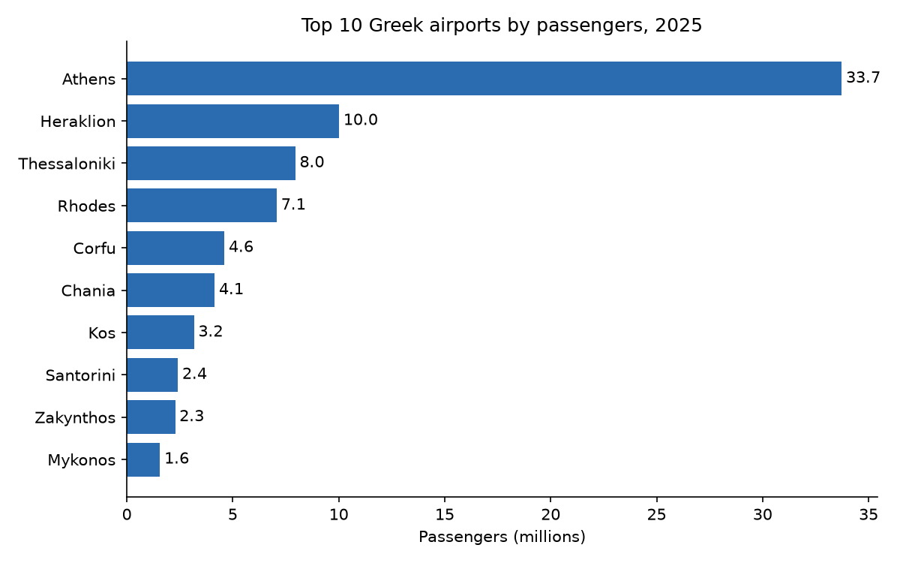
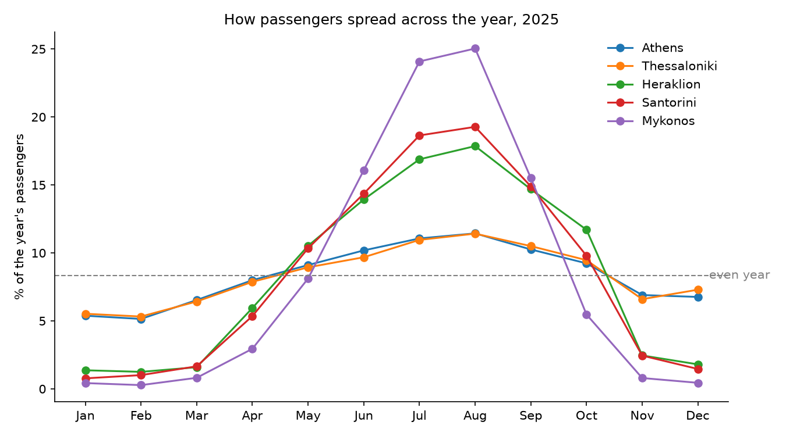
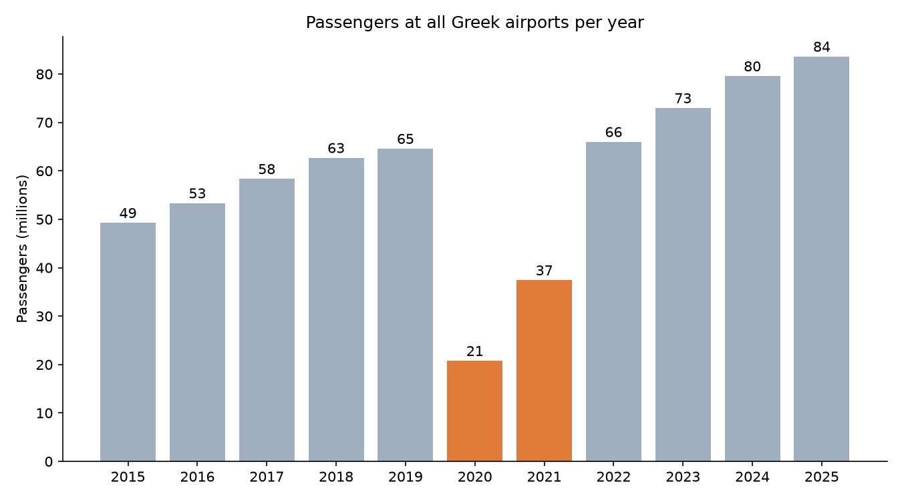

# Greek Air Traffic

How much does each Greek airport depend on the summer tourist season?

This project analyses monthly passenger numbers for all 47 Greek airports reported to Eurostat, from 1999 to today. It looks at three questions:

1. Which airports carry the most passengers?
2. How seasonal is each airport (summer vs. winter traffic)?
3. How did traffic change before, during and after COVID-19?

## Key findings

**1. Athens handles 4 out of 10 passengers.** In 2025 Greek airports served 83.6 million passengers. Athens alone had 33.7 million (40%), followed by Heraklion (12%) and Thessaloniki (9.5%). Seven of the top 10 airports are on tourist islands.



**2. Island airports live on four summer months.** Skiathos gets 88% of its yearly passengers between June and September, and the Ionian airports (Preveza, Kefalonia, Zakynthos) are above 80%. Athens and Thessaloniki stay close to an even year (about 43%), and Alexandroupoli is the most even of all (35%).



**3. COVID-19 cut traffic by two thirds, but recovery was fast.** Passengers fell from 64.6 million in 2019 to 20.8 million in 2020 (-68%). Traffic was back above 2019 levels in 2022, and in 2025 it was 29% higher than before the pandemic. Every large airport is back to its 2019 level or higher (the lowest is Kavala, at -0.1%).



**4. Less seasonal airports were hit less by COVID.** Airports that mostly serve local travellers all year (Lemnos, Alexandroupoli, Chios) lost about 45% of passengers in 2020. Most tourist island airports, like Zakynthos, Chania and Santorini, lost 70-80%.

Growth after COVID is very uneven: Paros (+65%) and Skiathos (+53%) grew fast, while Mykonos and Santorini grew only 6-8%. One possible explanation is that the already busy islands are close to their capacity, but this data alone cannot confirm it.

## Data

- Source: [Eurostat, dataset `avia_paoa`](https://ec.europa.eu/eurostat/databrowser/view/avia_paoa/default/table) (air passenger transport by main airports)
- Measure: passengers carried, all flights (scheduled and charter), all destinations
- File: `data/greek_airports_passengers.csv`

### Notes on the data

- Airports with fewer than 100,000 passengers a year are left out of the seasonality and COVID comparisons. With very small numbers, a few flights can change the percentages a lot.
- About 15% of the rows are marked by Eurostat with the flag `u` (low reliability). They are kept in the analysis.
- 2025 is used as the latest full year. The data for 2026 covers only January to March.
- Five airport codes (LG03, LG04, LGMG, LGRD, LGVO) are shown with their code instead of a name.

## How to run

Requirements: Windows with PowerShell, Python 3.13 and VS Code with the Jupyter extension.

```powershell
# 1. Create a virtual environment and install the libraries
python -m venv .venv
.venv\Scripts\python.exe -m pip install -r requirements.txt

# 2. (Optional) Download the latest data from Eurostat
powershell -ExecutionPolicy Bypass -File .\download_data.ps1
```

3. Open `analysis.ipynb` in VS Code, select the `.venv` kernel and click **Run All**. The charts are also saved in the `images/` folder.

## Tools

Python, pandas, matplotlib, Jupyter.
